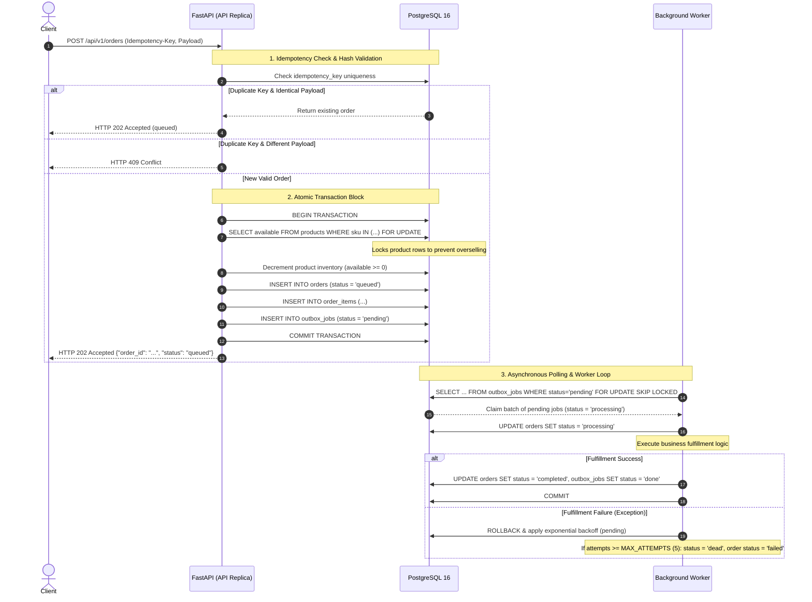

# FulfillOps - System Architecture and Design Document

## 1. System Overview
FulfillOps is a high-throughput, highly resilient e-commerce order intake and asynchronous fulfillment engine. Designed to withstand network partitions, process crashes, and high-concurrency traffic spikes without data loss or inventory overselling, the system is architected around Python 3.11, FastAPI, SQLAlchemy 2.0, PostgreSQL 16, and Kubernetes GitOps via Argo CD.

---

## 2. High-Level Component Flow Diagram

---

## 3. Core Architectural Patterns

### A. The Transactional Outbox Pattern
To guarantee at-least-once durable background processing without introducing external message brokers like Redis, RabbitMQ, or Kafka, FulfillOps implements the Transactional Outbox Pattern. Writing to a database and publishing an event to a queue in two separate steps introduces classic distributed systems failure modes, such as a successful database commit followed by a dropped network connection before queue publication. 

Our solution writes the order, order items, inventory decrement, and an outbox job record into a single atomic PostgreSQL transaction. If any part fails, the entire transaction rolls back. A background worker periodically polls the outbox table to drive asynchronous completion.

### B. Concurrency Control and Row-Level Locking
To prevent race conditions where multiple concurrent clients purchase the last remaining items simultaneously, the API acquires an explicit row-level lock using SQLAlchemy's with_for_update method on the products table. Transactions queue sequentially, guaranteeing that available stock never drops below zero, enforced by database constraints.

With multiple worker replicas polling simultaneously, duplication must be prevented. Workers utilize SELECT ... FOR UPDATE SKIP LOCKED. When Worker 1 claims a batch of pending jobs, PostgreSQL immediately locks those rows and instructs Worker 2 to skip them and look for other available work, eliminating race conditions and double-processing.

### C. Cross-Replica Idempotency
Clients retrying failed network requests can bombard the API with duplicate orders. Every request requires a valid Idempotency-Key header between 8 and 128 characters. The API computes a SHA-256 hash of the normalized JSON payload. If a request arrives with an existing key and matching hash, it safely replays the original 202 Accepted response without re-deducting inventory. If the key matches but the payload differs, it rejects the request with HTTP 409 Conflict.

---

## 4. Deployment and Infrastructure Topology

FulfillOps runs inside a localized Kubernetes cluster managed via GitOps:
- PostgreSQL 16 StatefulSet: Provides a persistent volume and a reliable database endpoint.
- Alembic Migration Job: An Argo CD synchronization hook that runs database migrations before application code starts.
- API and Worker Deployments: Two replicas each, configured with a zero-downtime rolling update strategy, liveness probes, and readiness probes verifying database connectivity.
- Security Hardening: All application containers run as unprivileged user and group UID 10001, with read-only root filesystems, dropped Linux capabilities, and no privilege escalation.

